<h1 align="center">Hey, I'm Eastwood 👋</h1>

  Full-Stack & Mobile Developer · Building for Ghana and beyond

  
  
  

---

I'm a Computer Science student at the **University of Ghana** who builds real products — not just side projects. I care about software that actually fits the people using it, especially in the Ghanaian context.

Currently working on:
- 🎓 **Brilla** — NSMQ quiz prep app for SHS students, with 6,900+ real past questions

---

### 🛠️ Tech Stack

**Frontend**

**Mobile**

**Backend**

---

**Programming Languages**

**Tools & Workflow**

**Currently Exploring: AI & Data Science**

### 📊 GitHub Stats

  
  

---

### 📈 Contribution Activity

  

  

